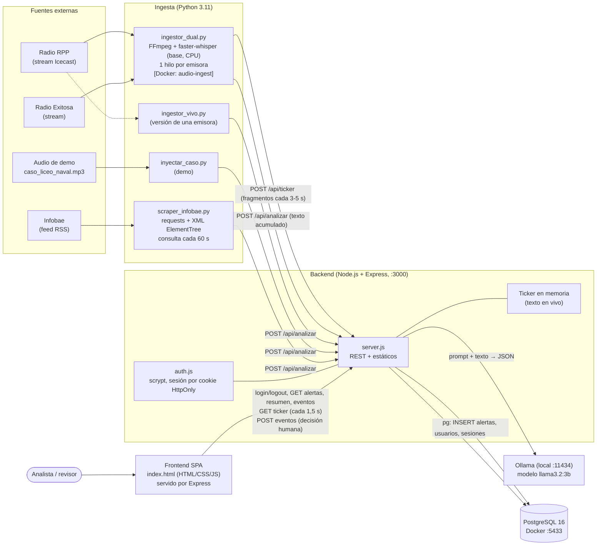
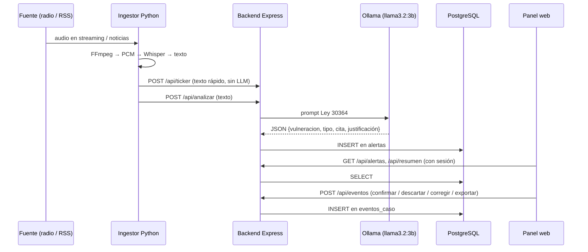

# Arquitectura de Qhaway Medios (IA_MUJER)

Sistema que monitorea radio en vivo y prensa digital, detecta posibles vulneraciones a la **Ley 30364** (violencia contra la mujer) con un LLM local y las presenta en un panel web con revisión humana.

## Diagrama general

## Flujo de una alerta (secuencia)

## Componentes y tecnologías

| Componente | Carpeta / archivo | Tecnología | Rol |
|---|---|---|---|
| Ingesta de radio | `audio-ingest/ingestor_dual.py` | Python, FFmpeg, faster-whisper, numpy, requests | Captura el stream de RPP y Exitosa, transcribe en CPU y envía el texto al backend. Corre en Docker (`audio-ingest/Dockerfile`, `python:3.11-slim`) o en local |
| Ingesta de una emisora / demo | `ingestor_vivo.py`, `inyectar_caso.py` | Igual que arriba | Captura de una sola emisora y reproducción de un caso pregrabado para demostraciones |
| Ingesta de prensa | `prensa-ingest/scraper_infobae.py` | Python, requests, XML (RSS) | Lee el RSS de Infobae cada 60 s, evita duplicados por URL y envía cada noticia a analizar |
| Backend | `backend/server.js`, `auth.js`, `crear_usuario.js` | Node.js, Express 4, cors, pg | API REST, orquestación del análisis, sesiones y sirve el frontend |
| Análisis con IA | Ollama (externo al repo) | LLM `llama3.2:3b` (configurable por `OLLAMA_MODEL`/`OLLAMA_URL`) | Clasifica el texto según la Ley 30364 y devuelve JSON |
| Base de datos | `docker/docker-compose.yml`, `init.sql` | PostgreSQL 16 (Alpine) en Docker, volumen `postgres_data` | Tablas `alertas`, `usuarios`, `sesiones`, `eventos_caso` |
| Frontend | `backend/public/index.html` | HTML + CSS + JavaScript sin framework (fetch + `setInterval`) | Login, monitoreo en vivo, detalle de casos, observatorio y revisión humana |
| Orquestación local | `iniciar_qhaway.bat` y `ejecutar_*.bat` | Scripts de Windows | Levantan Docker/Postgres, Ollama, backend y la captura de radio |

## Cómo interactúan

1. **Ingesta → Backend (HTTP/JSON).** Los ingestores no tocan la base ni el LLM; solo hacen `POST` al backend (`BACKEND_URL`, por defecto `localhost:3000`; desde Docker usa `host.docker.internal:3000`).
   - `/api/ticker`: fragmentos cortos para mostrar texto en vivo sin esperar al LLM (se guarda en memoria).
   - `/api/analizar`: texto completo para clasificar.
2. **Backend → Ollama (HTTP).** `/api/analizar` envía un prompt a `OLLAMA_URL` y espera una respuesta JSON; si no es JSON válido, extrae el objeto con una expresión regular.
3. **Backend → PostgreSQL (`pg`).** Cada resultado se inserta en `alertas`. Al iniciar, el backend crea las tablas que falten y reintenta cada 5 s si la base aún no está lista.
4. **Frontend → Backend (HTTP + cookie).** La SPA la sirve el mismo Express. Consulta el ticker cada 1,5 s y sincroniza alertas cada 3 s (polling, sin WebSockets). Las rutas `/api/alertas`, `/api/resumen` y `/api/eventos` exigen sesión.
5. **Seguridad.** Contraseñas con `scrypt` y sal; la sesión es un token aleatorio en cookie `HttpOnly; SameSite=Strict` que se guarda hasheado (SHA-256) en `sesiones` y expira a las 12 h. Hay límite de 5 intentos fallidos por minuto.
6. **Revisión humana.** El analista confirma, descarta o corrige cada alerta, o la exporta; el backend lo registra en `eventos_caso` con revisor, modelo y comentario, para tener trazabilidad.

## Endpoints del backend

| Método | Ruta | Sesión | Uso |
|---|---|---|---|
| POST | `/api/login`, `/api/logout` | no | Iniciar y cerrar sesión |
| GET | `/api/sesion` | no | Estado de la sesión |
| POST/GET | `/api/ticker` | no | Texto en vivo (ingesta escribe, panel lee) |
| POST | `/api/analizar` | no | Análisis con IA y guardado |
| GET | `/api/alertas` | sí | Listado con filtros y paginación |
| GET | `/api/resumen` | sí | Indicadores del observatorio |
| GET/POST | `/api/eventos` | sí | Decisiones y exportaciones |

## Puertos y despliegue

- `:3000` backend y frontend · `:5433` PostgreSQL (contenedor `ia_mujer_postgres`) · `:11434` Ollama.
- Todo corre en la máquina local; ningún texto sale a servicios de IA en la nube. Los únicos accesos externos son los streams de radio y el RSS de Infobae.
